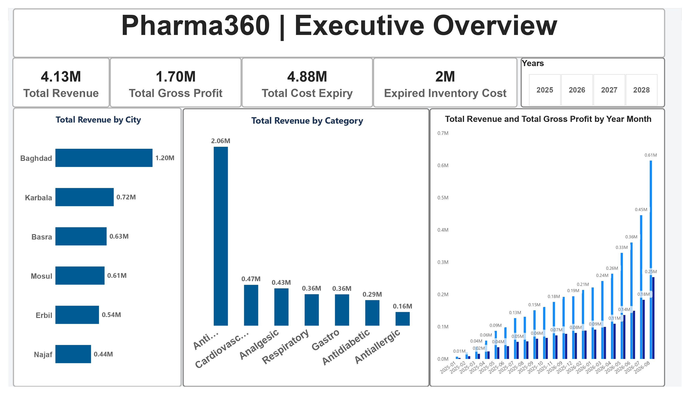
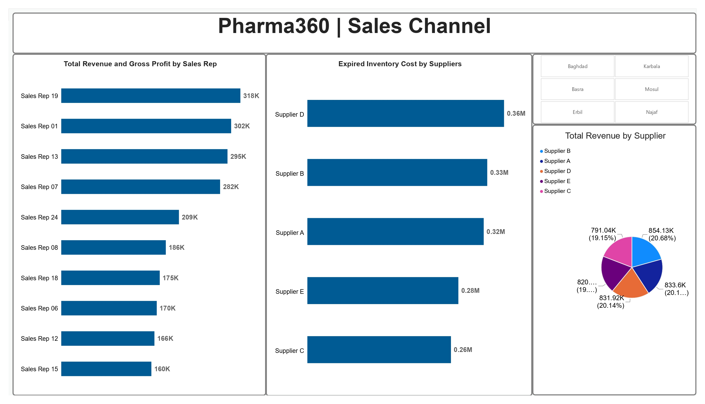
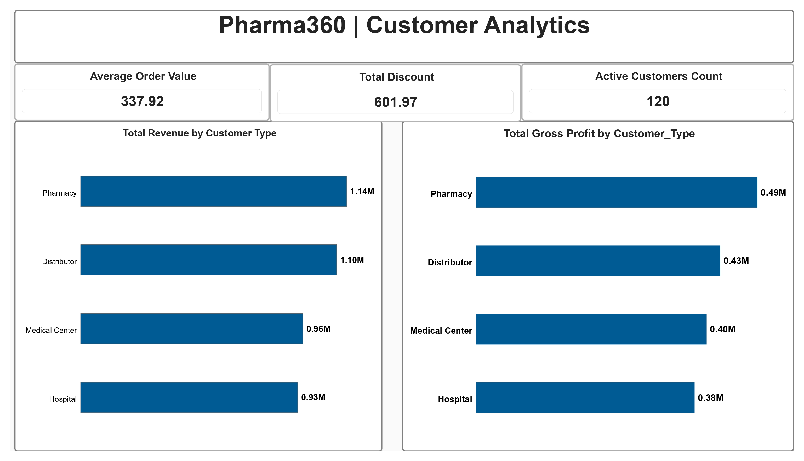
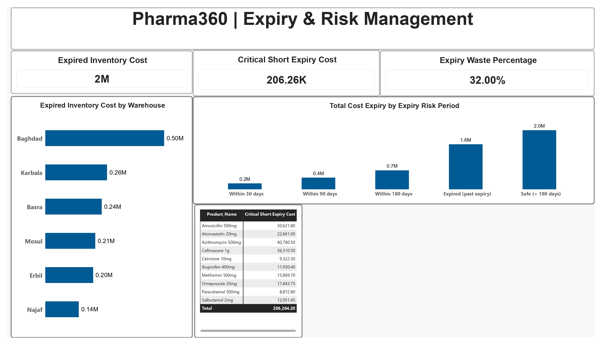

# 💊 Pharma360: Pharmaceutical Sales & Inventory Risk Analytics

## 📌 Executive Summary
**Pharma360** is an end-to-end data analytics solution designed to provide executive visibility into pharmaceutical distribution metrics, revenue growth, and inventory risk exposure. The project bridges database management in **MySQL** with high-impact data visualization in **Microsoft Power BI**, focusing on waste reduction through **FEFO (First-Expired, First-Out)** inventory management strategies.

> ⚠️ **Disclaimer:** *This dataset is simulated for data analytics and business intelligence portfolio demonstration purposes and does not represent real commercial data for any pharmaceutical entity.*

---

## 📊 Key Business Insights & Financial KPIs
* **Total Revenue:** `$4.13M` across major Iraqi territories.
* **Total Gross Profit:** `$1.70M` with consistent year-over-year revenue escalation.
* **Expired Inventory Risk:** Identified `$2.00M` in fully expired stock and `$206.26K` in critical short-expiry inventory (< 90 days), triggering automated dispatch alerts.
* **Top Revenue Region:** **Baghdad** leads regional distribution with `$1.20M` in net sales.
* **Top Customer Segment:** **Pharmacies** generated `$1.14M` in revenue and `$0.49M` in gross profit.

---

## 🛠️ Technical Architecture & Tools
* **MySQL 8.0:** Data modeling, schema creation, CTEs, Window Functions, and `DATEDIFF` logic for expiry risk classification.
* **Microsoft Power BI:** Multi-page dashboard development, dynamic DAX metrics, UI/UX grid alignment, and custom color palettes.
* **Data Modeling:** Star Schema linking Fact Sales, Fact Inventory, and Dim Tables (Date, Product, Customer, Sales Rep, Supplier, Warehouse).

---

## 📸 Dashboard Preview

| Page 1: Executive Overview | Page 2: Sales Channels |
| :---: | :---: |
|  |  |

| Page 3: Customer Analytics | Page 4: Expiry & Risk Management |
| :---: | :---: |
|  |  |

---

## ⚙️ How to Replicate this Project
1. **Database Setup:** Load the provided `Pharma360(1).sql` file into your local **MySQL Workbench**.
2. **Power BI Connection:** Open `Pharma360.pbix` in Power BI Desktop and refresh the data connections.
